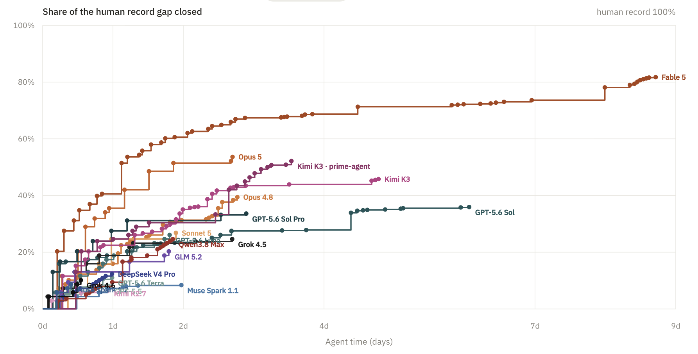
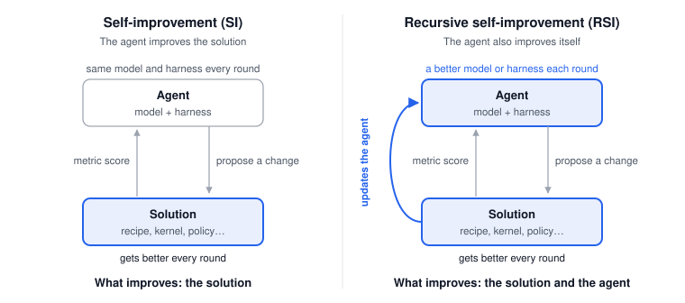
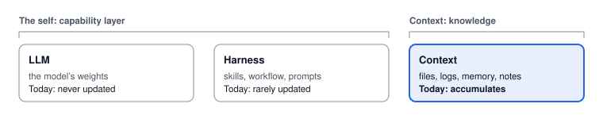

<strong>TL;DR:</strong> We've automated the improving, but the improver stays the same. Most of what gets called recursive self-improvement (RSI) today is self-improvement: an agent improves a solution by itself, in a loop, while the model and harness doing the work never change.

Everyone is talking about RSI right now. It's the new hot concept everyone is chasing. Yet another neolab launched to build RSI. Yet another paper does RSI for chips, robots or science.

I get where the hype comes from, and the progress is real. However, I think we're abusing the word so much, and we haven't thought thoroughly about what it means. The fact is:

**Most of what gets called RSI is just SI**, and we are ignoring an important part of RSI: whether the agent itself improves, and how we would evaluate that.

<!-- ## Two meanings of "self"

Jeff Dean drew this line in his recent conversation with Fei-Fei Li at Stanford [<a href="#ref-1">1</a>]. He said Silicon Valley tends to conflate two things: self-improvement, where a system is handed a measurable goal and tries different approaches until it hits it, and recursive self-improvement, where the system doing the improving also gets better at improving itself.

That made me realize "self" carries two levels of meaning. In self-improvement, the self is who does the improving: the system improves something by itself, but the self is not improving. In recursive self-improvement, the self is also what gets improved. The improvement loops back and updates the self, and that loop back is what "recursive" adds. -->

## Self-improvement: the agent as a universal optimizer

Agents are getting more and more capable at long-horizon engineering tasks, so people have started handing them work that used to need a human in the loop, putting the agent where the scientist or engineer used to be. Agents now write faster GPU kernels for training and serving foundation models [<a href="#ref-7">7</a>, <a href="#ref-8">8</a>]. They work on science problems that can be solved by writing code and running simulations [<a href="#ref-9">9</a>], as in the <a href="/blog/2026/nanoproteinlm-agenticls/">NanoProteinLM</a> project. In robotics, they write and rewrite control policies, using a vision-language model's read of each trial as feedback [<a href="#ref-10">10</a>]. Basically, anything that can be done by writing code, with a quantitative metric to optimize, is fair game.

This shows up most clearly in what people call autoresearch [<a href="#ref-2">2</a>]. You will often see a hill-climbing curve: a quantitative metric scores each solution the agent proposes, and the goal is to climb that metric as fast and as high as possible. These curves appear in the blogs of nearly every company working on RSI [<a href="#ref-8">8</a>, <a href="#ref-11">11</a>, <a href="#ref-12">12</a>].<a href="#note-who">1</a>Side note 1Who is building "RSI"? <a href="https://www.recursive.com/articles/first-steps-toward-automated-ai-research">Recursive</a> automates the AI research loop [<a href="#ref-8">8</a>]. <a href="https://www.primeintellect.ai/blog/measuring-autonomous-research">Prime Intellect</a> ran 153 autonomous runs on the nanoGPT speedrun across 18 models to measure research ability [<a href="#ref-11">11</a>]. <a href="https://www.adaptionlabs.ai/blog/autoscientist">Adaption</a> offers AutoScientist, which co-optimizes training data and recipes [<a href="#ref-12">12</a>]. <a href="https://mirendil.com/">Mirendil</a> trains frontier models that are expert at AI R&amp;D [<a href="#ref-4">4</a>]. Ricursive Intelligence wants to close the loop between AI and the chips it runs on [<a href="#ref-13">13</a>]. Jeff Dean's Discovery Loop runs about 20 automated improvement loops on its own ML work, but has no blog yet [<a href="#ref-1">1</a>, <a href="#ref-3">3</a>].

<figure>

<figcaption>Hill-climbing curves from Prime Intellect's nanoGPT speedrun experiment [<a href="#ref-11">11</a>]: the share of the gap to the human record that each model closed over up to nine days of autonomous work. Figure from Prime Intellect; see their <a href="https://www.primeintellect.ai/research/nanogpt-speedrun">interactive version</a>.</figcaption>
</figure>

You see, people have been following the agent-as-optimizer path to build optimization loops for everything, which is truly amazing. Those hill-climbing curves rise fast and high [<a href="#ref-11">11</a>]. So, is that RSI already?

## Defining recursive self-improvement
One thing that's easily overlooked is the meta layer that "recursive" adds to RSI. Self-improvement refers to a system that closes a loop and improves something by itself.<a href="#note-dean">2</a>Side note 2Jeff Dean drew this same line in a recent conversation with Fei-Fei Li: in self-improvement, a system is handed a measurable goal and tries approaches until it hits it, while in recursive self-improvement, the system doing the improving also gets better at improving itself [<a href="#ref-1">1</a>]. But does the agent improve its own understanding of the task, or learn new skills or insights? Or is it just another diligent, super brilliant graduate student who tries out every research idea but never stops to develop insights?

That's the meta level of improvement that "recursive" stands for: whoever completes the loop, the agent or the system, is also improving itself at the same time.

<figure>

<figcaption>Self-improvement versus recursive self-improvement. In both, the agent proposes changes and a metric scores them, so the solution gets better every round. In RSI, the loop also updates the agent itself: its model or harness.</figcaption>
</figure>

Well, think about how a good researcher or engineer would approach a problem. They don't just keep their head down and try every solution they could ever think of. They learn from trial and error, and they gain insights as they explore. Eventually, they get better at solving that problem, or even that family of problems. This part of capability gets far too little attention.

So in RSI, solving a problem and autonomously improving its solution is not enough. What also matters is the ability to keep learning from the problem and improve one's own capability to solve it.

## What is the "self" in recursive self-improvement?

A modern agentic system consists of three things: the LLM, the harness and the context. The LLM is the model's weights. The harness is made up of the skills, workflow and prompts around the LLM. Together, they make up the "self" of an agent.

<figure>

<figcaption>The three parts of an agentic system. The LLM and the harness form the self; the context is knowledge. In today's loops, only the context changes.</figcaption>
</figure>

The agent is then put into a context. The context is all the artifacts the agent can draw on: files in the working directory, agent logs and memory systems. I keep the context out of the self, because accumulating knowledge does not equal improving oneself.

In most "RSI" settings people talk about today, the agent works in a loop to optimize a solution for a certain task. The context gets updated with past failed attempts, logs and notes, but the other two layers, the language model itself and the harness, are usually not updated.<a href="#note-partial">3</a>Side note 3A few systems are starting to touch the self. The <a href="https://arxiv.org/abs/2505.22954">Darwin Gödel Machine</a> and <a href="https://arxiv.org/abs/2603.19461">Hyperagents</a> rewrite the agent's own code while the model stays frozen, and <a href="https://arxiv.org/abs/2506.10943">SEAL</a> lets a model write its own fine-tuning data. None of them closes the loop yet. Memory systems that only accumulate notes stay on the SI side.

## Why does this matter at all?

For those who have been working on autoresearch or RSI, this might sound familiar. You build an environment and an eval metric for your agent to loop on, and the hill-climbing curve is amazing at the beginning. Then, quickly, the curve plateaus, and your agent is cluelessly adjusting parameters or trying trivial fixes.<a href="#note-prime">4</a>Side note 4Prime Intellect saw something similar at scale: across 153 autonomous runs on the nanoGPT speedrun, the models mostly rediscovered known ideas, and none produced a fundamentally new method [<a href="#ref-11">11</a>].

<!-- TODO figure idea: a human vs. agent hill-climbing curve, where the human curve doesn't plateau the same way. Needs real data, e.g. from the NanoProteinLM search runs. -->

The base model, and the agentic system built on top of it, is now strong enough to look at the history in its context and improve its solution recursively. But keeping the "self" fixed makes continual learning impossible: the system can't actually learn and get better while it's solving a particular problem, which is what humans do.

## Conclusion

What we are mostly building today under the name of RSI is SI. That is not to undermine how effective SI is. Engineers and researchers are actively working alongside SI agents that reflect and improve<a href="#note-labs">5</a>Side note 5Frontier labs are a middle case. At OpenAI and Anthropic, researchers work with SI agents to build the next generation of the same models. That can count as RSI at another level, where the "self" is the model family [<a href="#ref-5">5</a>, <a href="#ref-6">6</a>]. But the process is not automatic, and it still takes a lot of human effort., though the insights still mostly come from human experts. It's impressive performance all the same.

So the goal of this post is not to undermine anyone's efforts to build self-improvement. It's a rethinking of RSI itself. There is so much hype about how much SI can achieve that we're ignoring the part that makes it recursive: the continual learning capability of the model itself. In the next post, I'll look at how we could actually evaluate that.

## References

<ol class="refs">
<li id="ref-1">OfficeChai. <a href="https://officechai.com/ai/implausible-that-self-improvement-loops-will-run-infinitely-fast-jeff-dean/">"Implausible" that self-improvement loops will run infinitely fast: Jeff Dean</a>. November 2026. Report on Jeff Dean in conversation with Fei-Fei Li, Stanford, October 28, 2026 (<a href="https://www.youtube.com/watch?v=ooGKNwJWdb8">video</a>).</li>
<li id="ref-2">Andrej Karpathy. <a href="https://github.com/karpathy/autoresearch">autoresearch</a>. March 2026.</li>
<li id="ref-3"><a href="https://www.discoveryloop.com/">Discovery Loop</a>.</li>
<li id="ref-4"><a href="https://mirendil.com/">Mirendil</a>.</li>
<li id="ref-5">Anthropic. <a href="https://www.anthropic.com/institute/recursive-self-improvement">When AI builds itself</a>. June 2026.</li>
<li id="ref-6">OpenAI. <a href="https://openai.com/index/introducing-gpt-5-3-codex/">Introducing GPT-5.3-Codex</a>. February 2026.</li>
<li id="ref-7">Google DeepMind. <a href="https://deepmind.google/blog/alphaevolve-a-gemini-powered-coding-agent-for-designing-advanced-algorithms/">AlphaEvolve: A Gemini-powered coding agent for designing advanced algorithms</a>. May 2025.</li>
<li id="ref-8">Recursive Superintelligence, Inc. <a href="https://www.recursive.com/articles/first-steps-toward-automated-ai-research">First steps toward automated AI research</a>. June 2026.</li>
<li id="ref-9">Anthropic. <a href="https://www.anthropic.com/research/claude-uplifts-biomolecular-modeling">How Claude is uplifting biomolecular modeling</a>. September 2026.</li>
<li id="ref-10">Vaishak Kumar. <a href="https://arxiv.org/abs/2603.04466">Act–Observe–Rewrite: Multimodal coding agents as in-context policy learners for robot manipulation</a>. March 2026.</li>
<li id="ref-11">Elie Bakouch and Prime Intellect. <a href="https://www.primeintellect.ai/blog/measuring-autonomous-research">Measuring autonomous AI research</a>. August 2026.</li>
<li id="ref-12">Adaption. <a href="https://www.adaptionlabs.ai/blog/autoscientist">AutoScientist: Automating the science of model training</a>. May 2026.</li>
<li id="ref-13">Sequoia Capital, Training Data podcast. <a href="https://sequoiacap.com/podcast/how-ricursive-intelligences-founders-are-using-ai-to-shape-the-future-of-chip-design">How Ricursive Intelligence's founders are using AI to shape the future of chip design</a>.</li>
</ol>
